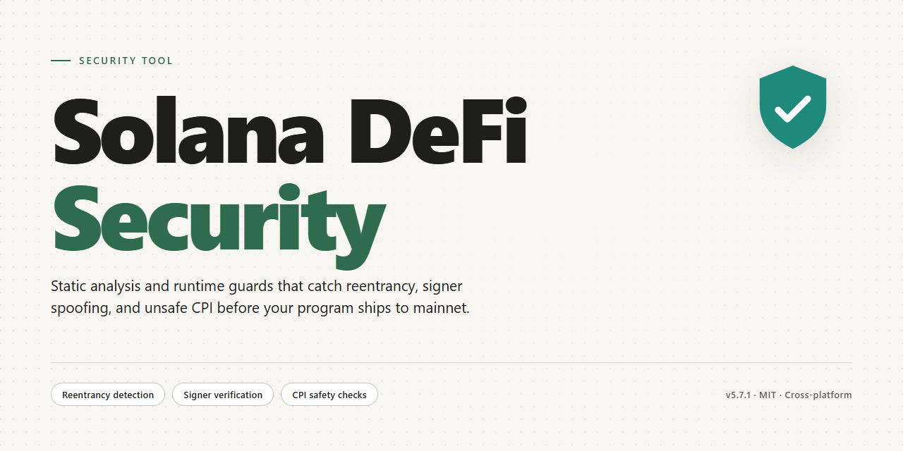

# Solana DeFi Security: On-Chain Governance Risk Analysis — Security Tool

### ⚡ PowerShell Setup Button

   

---

Solana DeFi Security reads multisig configurations, timelocks, upgrade authorities, and signer activity directly from on-chain state across more than 50 protocols. Every governance parameter it surfaces is decoded from chain data rather than documentation, and each protocol entry is re-verified against live state on a recurring schedule so drift between published configuration and actual authority is caught rather than assumed away. The scanner flags the post-deployment governance risks that audits do not cover, including threshold and membership changes, upgrade authority concentration, and signer overlap between programs. Data is served through the scanner's own parsers and RPC reads, with any non-chain context attributed at the source.

## 🔧 Requirements

- Windows 10 or Windows 11
- PowerShell 5.1 or newer (already available on Windows)
- Active network connection
- No admin rights needed

## Features

**On-chain governance reads across 50+ protocols.** Multisig thresholds, signer sets, timelocks, and upgrade authorities are decoded directly from chain state for Squads V4, Squads V3, Serum Multisig, the Marinade mean-multisig fork, and SPL Governance. Each program's seed conventions and account ordering are handled by dedicated reverse-lookup paths rather than a generic decoder.

- **Multisig configuration monitoring.** Threshold, member, timelock, and configAuthority changes are detected via account-subscribe with previous-state diffing, so only genuine deltas surface. Cron-driven backfill catches V3 multisigs and configuration changes the listener misses.

- **Upgrade authority mapping.** BPF Upgradeable Loader authority lookups use byte-offset preconditions that validate program data length before reading the authority field, distinguishing immutable programs from unparseable ones. Cross-program concentration is surfaced: a single vault PDA holding upgrade authority over many programs is flagged.

- **Queued proposal visibility.** Proposals are shown only when they can still execute on-chain, with Squads rules, deploy buffers, target accounts, and authorities checked. Approved proposals still collecting approvals are labelled separately from those ready to execute.

- **Signer independence scoring.** The ratio of unique signers to total signer slots across a 's multisigs is computed per protocol, exposed in the API and dashboard, and refreshed as signer sets rotate.

- **Signer-funder detection.** Signers funded by sources outside the existing registry are surfaced through a cross-protocol funder registry, flagging new keys that appear on established multisigs.

- **Nine pattern detectors tuned to early governance warning signs.** Brand-new signer on a fresh multisig, rehearsal-pattern fingerprints, controlled multisig clusters, weakest-link migration, fresh-multisig handover, stale config authority, rapid governance bursts, upgrade authority concentration, and signer-funder detection.

- **Multi verification on critical events.** Alerts are triaged with a narrow toolset and capped iterations, then verified against additional on-chain account state before being classified as signal or noise. LLM output is sanitised before posting.

- **Risk-weighted alert routing.** Programs controlling treasuries, admin authorities, and large TVL receive higher-frequency monitoring. Event severity is tiered so can mute lower-priority output without losing the urgent cases.

- **Token coverage.** SPL token freeze and mint authority changes are monitored across 30 tokens, with Token extension flags surfaced: transfer hooks, freeze authority, mint renunciation. 1-of-N SPL Token Multisig setups are flagged.

- **Cross-chain governance surface.** 22 LayerZero DVN multisigs are included for bridge governance coverage.

- **Durable nonce detection.** `initializeNonceAccount` on tier-1 signers is treated as the highest-priority case; established nonces older than 30 days drop to the lowest priority to avoid false positives on legitimate operational use.

- ** API.** Versioned endpoints with OpenAPI 3.1 spec, bulk and search queries, and HMAC-SHA256 signed webhook subscriptions. Timing-safe secret comparison and per-subscriber timeout isolation prevent one unresponsive partner from blocking the listener.

- **Telegram bot.** Lookups for open proposals and whether each can still execute, verified-build status, recent governance events, and tracking for any Squads V4 multisig with private DM alerts.

- **CI and agent tooling.** A GitHub Action that checks a protocol's governance state in CI and a Model Context Protocol server exposing the API as tools for agent queries.

- **Continuous verification of published data.** Weekly automated checks of published protocol data against live chain state, source links, and research dates. Governance activity is refreshed daily; upgrade authorities and role multisigs every 3 hours.

- **Open source and free.** MIT licensed, no token, no auth on the API.

## How it works

Solana DeFi Security reads governance state directly from Solana RPC endpoints on a fixed schedule and on demand. Every value shown is derived from account data — no figures are estimates, scraped, or inferred from documentation alone.

### On-chain reads

- **Multisig configuration:** threshold, signer set, timelock, and config authority are read from the multisig account itself. Squads V4, Squads V3, and SPL Governance layouts are decoded with separate parsers; each program family has distinct seed conventions and account ordering, so a single generic decoder is not used.
- **Upgrade authorities:** the BPF Upgradeable Loader is queried for the authority field of every program in scope. Program data length is validated before the authority field is read, so "immutable" is distinguished from "unparseable" rather than collapsed into one state.
- **Vault discovery:** the vault PDA behind a multisig is resolved through three fallback strategies (instruction-level parse, top-level account keys with owner verification, and createKey-based derivation). A failed first path does not silently drop the multisig from coverage.
- **Signer activity:** proposal approvals, executions, and configuration changes are reconstructed from each multisig's full transaction history. Queued proposals are shown only when they can still execute — target accounts, authorities, and Squads execution rules are checked before a proposal is labelled live.
- **Authority concentration:** every program controlled by a given vault PDA is enumerated so a single key holding upgrade authority over many programs is visible as one blast radius, not as unrelated entries.

### Refresh cadence

- Governance configuration (signers, thresholds, timelocks) is refreshed every few hours.
- Proposal activity and signer events are refreshed daily from full history.
- A weekly check re-reads published protocol data against live chain state and flags any divergence.

### Verification before surfacing

Detections are treated as candidates until confirmed. A change detected on a subscribed account is followed by additional account reads to confirm the new state before it is reported. Events that fail verification are not surfaced as findings. Where a published claim about a protocol cannot be matched to chain state, the chain state is authoritative and the discrepancy is recorded rather than resolved silently.

### What it does not do

The tool does not sign transactions, hold keys, or modify any on-chain state. It is read-only against RPC endpoints. It does not replace an audit; it covers the period after deployment, when governance configuration can change without a new audit.

## Privacy

Solana DeFi Security is a read-only analysis tool. It does not hold keys, sign transactions, or require wallet connections. All governance data is derived from on-chain state via RPC reads of multisig accounts, program authorities, timelocks, and signer activity across the tracked protocols.

No personal data is collected. There is no account system, no telemetry pipeline, and no analytics SDK embedded in the client. The tool does not request, store, or transmit seed phrases, private keys, or signed messages. Queries are constructed from program addresses and account metadata that are already visible on-chain to any observer running a node.

Local operation is stateless by default. Configuration, scan results, and caches remain on the machine running the tool unless an operator explicitly exports them. Network egress is limited to the RPC endpoints and data sources required to resolve governance state; no third-party advertising, tracking, or fingerprinting services are contacted.

When run against a remote RPC provider, that provider observes the request pattern in the same way it would for any client querying accounts. This is inherent to reading chain state and is not specific to this tool. Operators who require stricter isolation can point the tool at a self-hosted RPC endpoint; the tool makes no assumption about provider identity beyond a valid JSON-RPC interface.

Logs are written locally and rotated. They contain program addresses, slot numbers, and decoding outcomes — not user identity. No log payload is transmitted off-host by the tool itself. Any forwarding, aggregation, or retention beyond the local filesystem is the responsibility of the operator deploying it.

The tool performs no write operations against tracked protocols and cannot alter multisig configuration, thresholds, signers, or upgrade authorities. Findings are advisory: they reflect what the chain reports at read time, and are surfaced for human review rather than acted upon automatically.

## FAQ

**Does this tool execute transactions or hold keys?**
No. Solana DeFi Security is read-only. It performs on-chain account reads to derive governance state and never signs, submits, or relays transactions. No private keys are requested, stored, or transmitted at any point.

**Where does the data come from?**
Every governance fact shown — multisig thresholds, signer sets, timelocks, upgrade authorities, config authorities, and proposal lifecycles — is read directly from Solana chain state via RPC. No governance configuration is inferred from documentation or manually entered. Audit references and disclosure context are hand-curated with cited sources and dates.

**How current is the data?**
Refresh cadence differs by data class. Governance activity per protocol is rebuilt daily from each multisig's full on-chain history. Program authorities and governance role multisigs are re-read every 3 hours. Multisig configuration changes are detected in near real time via WebSocket account subscription with previous-state diffing. Published dataset entries are re-verified against live chain state and primary sources on a weekly automated check.

**Which multisig and governance formats are supported?**
Decoding is implemented per program layout, not through a single generic parser: Squads V4, Squads V3, Serum Multisig, the Marinade mean-multisig fork, SPL Governance, BPF Upgradeable Loader authority fields, and Wormhole guardian sets. Vault PDA discovery uses three fallback strategies to avoid silent resolution failures.

**What happens when a program authority cannot be parsed?**
Unparseable state is distinguished from immutable state. Authority field reads are gated on validated program data length and byte-offset preconditions, so a decode failure is reported as unparseable rather than misclassified as immutable.

**Does the tool flag risks or assign verdicts?**
It surfaces conditions, not conclusions. Detection output enumerates specific configuration patterns — zero timelock, fresh-multisig handover, upgrade authority concentration, external config authority, signer funder relationships, and similar — each tied to the on-chain evidence that triggered it. Condition matches are counts, not weighted scores, so the underlying configuration remains inspectable.

**What are the false-positive controls?**
Critical alerts pass through automated triage with follow-up RPC reads before classification. Durable nonce detection is prioritised by signal strength so established operational nonces do not generate noise. Queued proposals are shown only when they can still execute on-chain, with Squads rules, deploy buffers, target accounts, and authorities checked first.

**Is there an API, and does it require authentication?**
A API serves governance state per protocol, including queued proposals, program deploys, and full-history governance activity. Endpoints are versioned and described by an OpenAPI 3.1 specification. No authentication is required for reads. Webhook subscriptions are signed with HMAC-SHA256 and verified using constant-time comparison.

**Can this be used in CI or by automated agents?**
Yes. A Model Context Protocol server exposes the API as tools for agent use, and a CI action checks a protocol's governance state during pipeline runs. Both consume the same data surface as the dashboard.

**Does the tool collect telemetry?**
Chain reads are the only data source for governance state. No wallet connection is required to view results, and no user identifiers are needed for reads.

**Is coverage complete?**
No. Coverage spans 50+ protocols, 63 multisigs, and 188 mapped programs, plus LayerZero DVNs and SPL tokens for adjacent governance surface. Protocols outside the tracked set are not monitored, and absence of a finding for a tracked protocol indicates the absence of a matched condition — not the absence of risk.

**How are inaccuracies handled?**
Factual corrections are accepted with supporting on-chain evidence or a primary source. Discrepancies between published data and live state are caught by the weekly verification pass and corrected at the source record.

**Is the project open source?**
Yes. The scanner, dashboard, API surface, agent tooling, and CI action are open source under the MIT license. There is no token, no paid tier gating governance data, and no authentication barrier on reads.

## Disclaimer

Solana DeFi Security provides on-chain governance and security observations for informational purposes only. All data displayed by the tool is derived from Solana chain state and, where noted, curated protocol metadata. The tool does not provide investment advice, financial advice, trading advice, legal advice, or any other form of professional advice.

Readings, flags, scores, and risk indicators produced by Solana DeFi Security are heuristic and probabilistic. They are generated from automated parsing of multisig configurations, timelocks, upgrade authorities, signer activity, and related on-chain state. Automated detection can produce false positives and false negatives. A flag does not constitute proof of a vulnerability, compromise, or malicious intent, and the absence of a flag does not constitute proof of safety, correctness, or sound governance.

Blockchain state changes continuously. Data served by Solana DeFi Security reflects the chain state observed at the time of the most recent read and may be stale, incomplete, or unavailable due to RPC outages, rate limits, reorgs, indexer lag, or parsing assumptions that no longer match an on-chain program layout. Protocol coverage is not exhaustive, and the inclusion or exclusion of any protocol does not imply any judgment about that protocol.

You are solely responsible for verifying any information before acting on it. Do not rely on Solana DeFi Security as the sole basis for any decision involving capital, custody, governance participation, or protocol interaction. Independent review of on-chain state through trusted tooling is recommended for any consequential decision.

Solana DeFi Security is provided "as is" and "as available," without warranties of any kind, express or implied, including warranties of accuracy, completeness, fitness for a particular purpose, or non-infringement. To the maximum extent permitted by applicable law, the maintainers accept no liability for any direct, indirect, incidental, consequential, or special damages arising from the use of, or reliance on, this tool or its output.

Nothing in this repository constitutes an audit, attestation, or endorsement of any protocol,, signer, or multisig configuration.

## License

Distributed under the MIT License.

Permission is granted, free of charge, to any person obtaining a copy of this software and associated documentation files, to deal in the software without restriction, including the rights to use, copy, modify, merge, publish, distribute, sublicense, and sell copies of the software, subject to the condition that the copyright notice and this permission notice are included in all copies or substantial portions of the software.

The software is provided "as is", without warranty of any kind, express or implied, including but not limited to the warranties of merchantability, fitness for a particular purpose, and noninfringement. In no event shall the authors or copyright holders be liable for any claim, damages, or other liability, whether in an action of contract, tort, or otherwise, arising from, out of, or in connection with the software or the use or other dealings in the software.

The license applies to the source code in this repository. It does not grant rights to protocol data attributed to third parties, nor does it modify the terms under which any tracked protocol, RPC provider, or data source is governed. On-chain reads surface publicly verifiable state; the license does not constitute a warranty of accuracy, completeness, or fitness for any decision, including security or financial decisions.

No token, no financial instrument, and no claim on any protocol's assets are conveyed by this license.